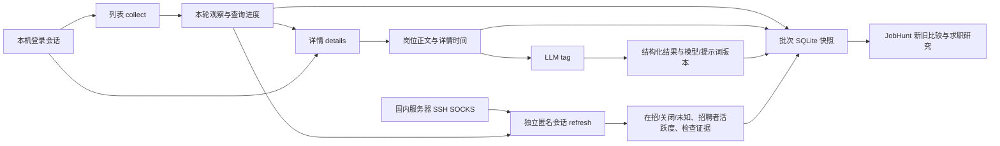

# 四条数据链路

网页与 CLI 共同管理列表采集、详情获取、模型抽取和经国内跳板的页面刷新。SQLite 保存原始数据和证据；批次编号将一轮的新观察与历史库区分。

采集器只执行数据读取，旧版内置开聊与发送动作已移除。旧配置里的 `auto_chat` 字段暂保留以读取历史配置，不再提供采集时自动联系的行为。

| 链路 | 当前入口与责任 |
|---|---|
| 列表 | `task start collect --round-id ...`；记录搜索结果、查询条件和本轮实际出现的岗位。关闭 `collect_details` 可独立运行列表。 |
| 详情 | `task start details --round-id ...`；使用列表中的详情凭据更新缺失/过期正文。获取时间独立于列表观察时间；凭据无效时停止连续失败并保留结果。 |
| LLM | `task start tag --round-id ...`；从岗位原文抽取结构化字段。端点、模型、密钥和提示词可更换，版本与输入快照保留。新的输出不覆盖旧模型意见。按批次打标只读取时效期内的正文；正文更新间隔设为 0 时，读取该批次开始后获取的正文。 |
| 跳板刷新 | `refresh.route=proxy` 配合 `refresh.proxy_server=socks5://127.0.0.1:<端口>`；SSH 转发到国内服务器。本地浏览器使用独立匿名目录，从真实岗位容器读取状态和活跃度。 |

采集登录会话和跳板匿名会话分别保存。跳板刷新拒绝使用采集目录或带登录凭据的会话；用户只处理页面验证。SSH 主机、端口和可用性由本机配置确定，旧记录仅作查找线索。

`round_id` 的续跑单位是完整查询，中途停止时重新读取该组查询，重复岗位不占用本次新岗位上限。按批次补详情、打标和刷新时，限量任务轮流从城市/首次查询词分组选取，避免只处理最后采集的城市或关键词。

平台验证保留人工处理入口，请求失败有超时，数据先落库再处理后续步骤。访问开关、平台状态和任务进度各有独立记录。使用一个新的批次编号重新观察市场，不用历史累计关键词或全库新增量代替本轮样本。

日常操作见 [OPERATIONS.md](OPERATIONS.md)，字段与时间口径见 [DATA_MODEL.md](DATA_MODEL.md)。

`list_source: native`读取网页自己的搜索/滚动列表响应，采集同时补详情时读取首次自动选中及按链接ID点击的卡片详情；存量`details`任务保留同源接口补全。网页分页与旧API分页不可混进同一批次。源码、真实三城市验收及控制台重启说明见 [原生采集](NATIVE_COLLECTION.md)。

网页业务、岗位身份、正文访问质量与公开项目取舍见 [架构依据](ARCHITECTURE.md)。列表/详情字段解析已独立到 `collectors/boss_payload.py`，可在不连接浏览器的情况下重放已有真实响应。快照同时保存批次、查询与观察来源；重放不作为新采集。

已取得的HAR、原生列表JSON或事件JSON可通过 [结构化数据输入](CAPTURE_IMPORT.md) 写入新的独立数据库。导入保留实际获取时间及来源哈希，未知访问不会自动进入模型抽取；导入不代表在线通道已恢复。

刷新有独立访问暂停和任务资源；主访问开关与全局人工暂停仍覆盖平台任务。模型抽取只输入岗位原文，不加入候选人的意向技能；本轮抽取要求详情访问已核验。模型输出和用户能力仍分开解释。
